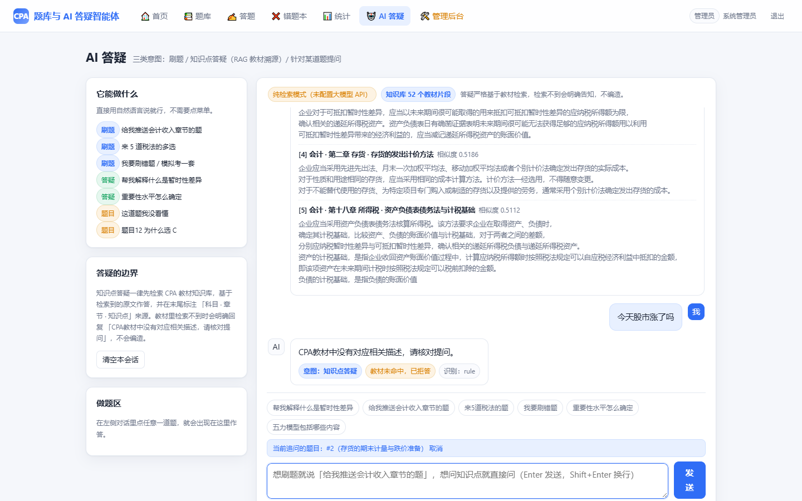
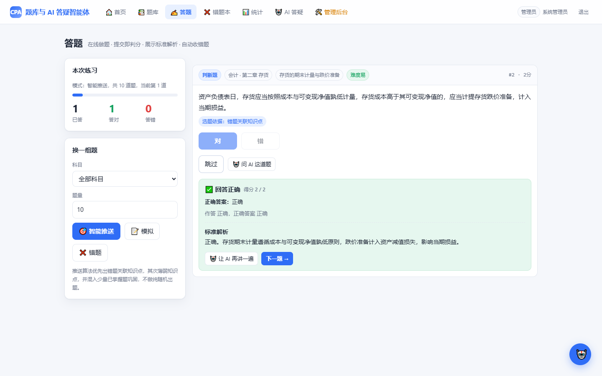
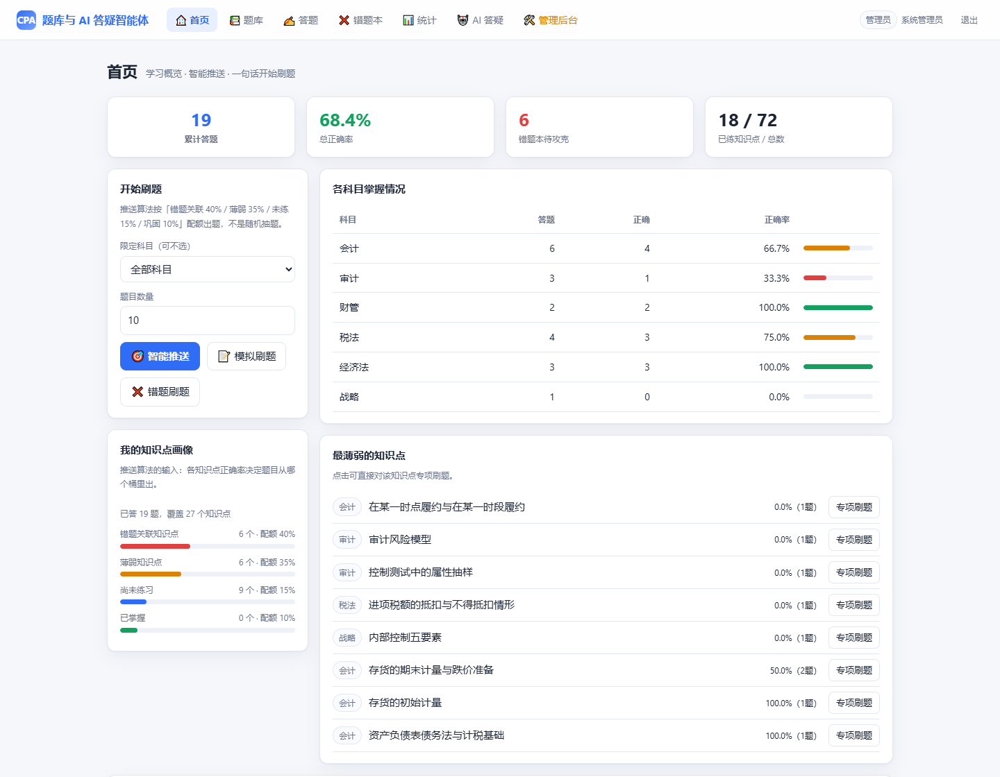
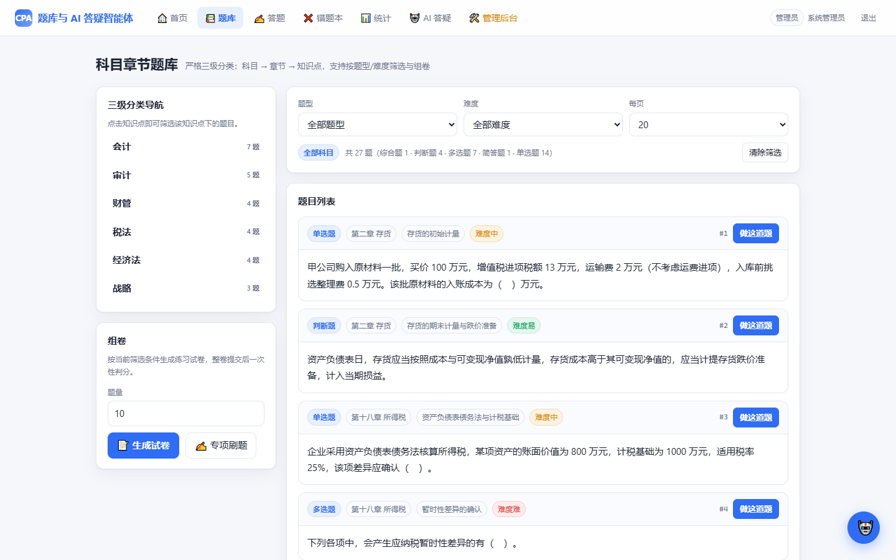
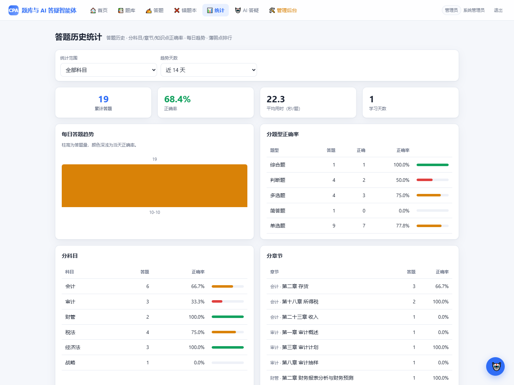
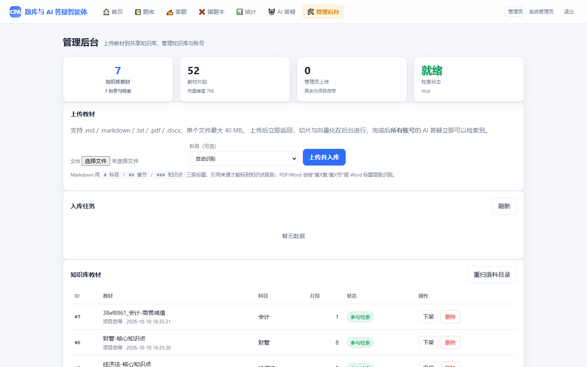

# CPA 题库与 AI 答疑智能体

一个可本地一键运行的注册会计师（CPA）备考系统：**题库刷题 + RAG 教材答疑智能体**。

后端 FastAPI + 标准库 `sqlite3`（手写 DDL，无 ORM），前端零框架，
内置账号登录、角色权限与数据隔离，**未配置任何大模型 API 也能完整运行**。


---

## 界面

**AI 答疑：检索教材原文作答，片段标注来源；检索不到直接拒答，不编造**



**答题：提交即判分，展示标准解析与本题的选题依据**



<table>
<tr>
<td width="50%"><b>首页：学习概览 + 知识点画像</b><br></td>
<td width="50%"><b>题库：三级分类 + 组卷</b><br></td>
</tr>
<tr>
<td width="50%"><b>答题历史统计</b><br></td>
<td width="50%"><b>管理后台：教材上传入库 + 账号管理</b><br></td>
</tr>
</table>

---

## 快速开始

```bash
pip install -r requirements.txt
python run.py --setup          # 建库 + 种子数据 + 教材入库 + 启动
# 打开 http://127.0.0.1:8000，用启动时打印的管理员账号密码登录
```

启动时会保证至少存在一个管理员账号，密码打印在控制台（或用 `CPA_ADMIN_PASSWORD` 指定）。

只装 `fastapi / uvicorn / starlette / itsdangerous / python-multipart / jieba / numpy`
也能跑通全站（含登录与权限），此时 RAG 自动降级到 hashing 向量后端；
想要中文语义检索再加装 `torch + transformers`。

---

## 三个模块

### 模块一：题库系统

- **严格三级分类**：科目 → 章节 → 知识点（6 科 / 24 章 / 72 知识点）；
  六科为 会计、审计、财管、税法、经济法、战略。
- **五种题型**：单选、多选、判断、简答、综合。每题含题目 ID、科目、章节 ID、
  知识点 ID、题干、选项、正确答案、标准解析、难度标签。
- **在线做题**：提交即判分，立即展示标准解析；多选漏选按 50% 计分，
  主观题按采分点命中率计分。
- **答题记录持久化**：每条记录含题目 id、用户作答、正确与否、答题时间、
  科目/章节/知识点、用时、刷题模式。
- **错题本**：做错自动收集，可查看、重做、移除、恢复，按科目/知识点筛选；
  连续答对 2 次自动脱离。
- **题目推送算法**：以答题历史、错题集合、各知识点正确率为输入，
  按四桶配额出题，**每道题都附带选题依据**，明确不做纯随机出题。
  支持专项章节刷题、模拟刷题、错题刷题三种模式。
- **组卷**：按科目/章节/知识点/题型/难度筛选生成试卷，整卷提交一次判分。
- **六个业务页面**：首页、科目章节题库页、答题页、错题本页、答题历史统计页、AI 答疑页；
  另有登录页与管理后台页（仅管理员可见入口）。

### 模块二：账号与权限

- **登录/登出/注册**：会话存签名 cookie（`SessionMiddleware`），每次请求回库确认账号仍启用、
  角色未被改，停用或降权立即生效，不用等 cookie 过期。
- **两种角色**：`student` 学员 / `admin` 管理员。学员访问管理接口与后台页面返回 403。
- **账号数据隔离**：答题记录、错题本、对话历史、统计全部按 `user_id` 隔离，
  请求里伪造 `user_id` 无效——`user_id` 一律取服务端会话，不信任客户端传入。
- **管理后台**（`/admin`）：账号管理（新建/停用/删除/改密码）、
  教材上传/下架/删除（全站共享知识库）、上传任务进度查看。

### 模块三：AI 答疑智能体

- **CPA 教材是唯一知识库**，RAG 模式，禁止凭空编造。
- **三类意图识别**：
  1. **刷题** —— 调题库、触发推送算法、进入答题流程；
  2. **知识点答疑** —— 检索教材原文作答，末尾标注引用来源（科目 · 章节 · 知识点）；
  3. **针对某道题提问** —— 题目 + 标准解析上下文 + 教材 RAG 拓展。
- **网页内置聊天框**，自然语言对话：
  「给我推送会计收入章节的题」「帮我解释什么是暂时性差异」「这道题我没看懂」。
- **检索元数据带科目/章节/知识点**，支持按科目过滤；
  检索不到时明确回复 **"CPA教材中没有对应相关描述，请核对提问。"**，绝不编造。

---

## 核心设计

### 1. 反幻觉：拒答判定放在程序层，不只靠提示词

三重保障，第一重在调用大模型之前：

1. **绝对阈值判定**（`app/rag/retriever.py`）：稠密余弦 < 0.53
   **且** BM25 按词均值 < 1.15 时，**根本不调用大模型**，直接返回拒答话术。
   阈值由 `scripts/calibrate_refusal.py` 在 35 条范围内 + 18 条范围外问题上标定，
   两组完全可分（误拒 0、误答 0）。
2. **提示词约束**：`RAG_QA_SYSTEM_PROMPT` 要求只用教材片段、
   不得补充片段外的数字与结论、片段无关时只输出那一句话。
3. **降级路径零生成**：未配置大模型时，答疑直接返回教材原文 + 来源，
   不产生任何生成文字。

判拒答用的是**绝对信号**而非排名：稠密路取原始余弦（跨查询可比），
稀疏路取 `BM25 原始分 ÷ 查询词数`（消掉"查询越长分越高"的量纲影响）。
两路都不达标才拒答，避免"换个说法就说教材里没有"的误伤。

### 2. 题目推送：四桶配额，不是随机抽题

把题量按比例切给四个桶，桶内再按权重分到具体知识点，最后在知识点内选题：

| 桶 | 配额 | 权重 |
| --- | --- | --- |
| 错题关联知识点 | 40% | 累计错次 |
| 薄弱知识点（正确率 < 0.7） | 35% | `(1 - 正确率) × log(作答量 + 1)` |
| 未接触知识点（探索） | 15% | 1（冷启动时这一档自动放大） |
| 已掌握知识点巩固 | 10% | 正确率 |

配额不足时按 ①→②→③→④ 顺序回填，仍不足才从范围内补题。
每次推送都会返回 `reason` 字段，前端直接展示给用户看。

### 3. 分层：业务层不依赖 AI

```
app/business/   业务层（题库 / 判分 / 错题本 / 推送 / 组卷 / 统计）—— 不 import agent，删掉 Agent 层仍可运行
app/rag/        RAG 层（切片 / 向量化 / BM25 / 混合检索 / 拒答 / 入库），对外只暴露 service.py
app/agent/      Agent 层（意图识别 / 编排 / 大模型调用 / 提示词）—— 不写 SQL，全走 business 与 rag
app/api/        HTTP 层，统一 {ok, data, error} 响应外壳
```

题库、判分、错题本、推送算法、统计这些功能**完全不依赖大模型**，
不需要 API Key，也不会因为模型服务抖动而不可用。

### 4. 降级矩阵：任何一格缺失都不会 500

| 缺失项 | 系统行为 |
| --- | --- |
| 未配置任何大模型 Key | 纯检索模式：答疑返回教材原文 + 来源，其余功能不受影响 |
| 未装 `torch/transformers` | 向量后端降级为 `hashing`（jieba + hashing trick），检索链路仍可跑 |
| 未装 `PyMuPDF / python-docx` | 跳过 PDF / Word 教材，md / txt 不受影响 |
| 本地模型加载失败 | 记录 warning 并降级，不让整站起不来 |
| 大模型调用超时/限流 | 捕获后降级为纯检索作答，对话不中断 |
| 知识库为空 | 明确提示"知识库为空，请先入库"，而不是给一堆幻觉 |

---

## 技术栈

| 层次 | 用什么 | 说明 |
| --- | --- | --- |
| Web 框架 | FastAPI + uvicorn | 统一 `{ok, data, error}` 响应外壳 |
| 存储 | 标准库 `sqlite3`，手写 DDL | 13 表 / 18 索引 / 2 视图，WAL + 外键，无 ORM |
| 登录会话 | Starlette `SessionMiddleware` | 签名 cookie，只放 id/用户名/角色，每次请求回库校验 |
| 密码 | PBKDF2-HMAC-SHA256 | salt 独立存储，24 万次迭代 |
| 中文分词 | jieba | BM25 检索用 |
| 向量检索 | numpy + transformers（手写 mean pooling） | 768 维，L2 归一化 |
| 稀疏检索 | 纯 Python 手写 BM25 | 中文分词 + bigram 补充 |
| 大模型调用 | 标准库 `urllib` | 不装 openai / anthropic SDK，换供应商只改 config |
| 前端 | 原生 HTML/CSS/JS | 无构建步骤，Jinja2 模板 + 静态资源 |

**刻意没有用的技术**：ORM、sentence-transformers、前端框架、向量数据库、大模型 SDK。
理由见 [docs/TECH_STACK.md](docs/TECH_STACK.md#刻意没有用的技术)。

> 本项目不使用 `sentence-transformers`（该环境下 `import` 会触发访问违例崩溃 0xC0000005），
> 改用 `transformers.AutoModel` + 手写 mean pooling + L2 归一化，输出与原方案等价。

---

## 目录结构

```text
cpa-agent/
├─ run.py                    一键启动（--setup / --init / --ingest / --port）
├─ config.py                 全部可调参数；【需要二次开发】的大模型配置集中在此
├─ requirements.txt
├─ app/
│  ├─ schema.sql             完整建表语句：13 表 / 18 索引 / 2 视图
│  ├─ db.py                  连接管理（WAL、外键、线程局部连接、事务）
│  ├─ webapp.py              FastAPI 应用工厂 + 会话中间件 + 8 个页面路由
│  ├─ business/              业务层（不依赖 AI，删掉 agent 层仍可运行）
│  │  ├─ auth.py             账号注册/登录校验/密码哈希/角色
│  │  ├─ catalog.py          三级分类 + 中文话术→id 解析
│  │  ├─ questions.py        题目查询/筛选/序列化（未提交前不下发答案）
│  │  ├─ grading.py          五种题型判分
│  │  ├─ records.py          答题记录（全站唯一写入口）
│  │  ├─ wrongbook.py        错题本状态机
│  │  ├─ recommend.py        四桶配额推送算法
│  │  ├─ paper.py            组卷 + 模拟卷题型配比
│  │  └─ stats.py            统计聚合
│  ├─ rag/                   RAG 层（对外只暴露 service.py）
│  │  ├─ chunker.py          按标题层级切片，标题即检索元数据
│  │  ├─ embedder.py         local / api / hashing 三级后端 + 静默降级
│  │  ├─ bm25.py             中文分词 + bigram 补充的 BM25
│  │  ├─ index.py            向量矩阵 + BM25 索引，进程内缓存
│  │  ├─ retriever.py        混合检索 + 拒答判定（反幻觉核心）
│  │  ├─ ingest.py           md5 增量入库，支持 md/txt/pdf/docx
│  │  ├─ uploads.py          管理员上传 + 后台入库任务队列
│  │  └─ service.py          RAG 独立服务门面
│  ├─ agent/                 Agent 层（不写 SQL）
│  │  ├─ prompts.py          全部提示词
│  │  ├─ intent.py           规则 + 大模型双路意图识别
│  │  ├─ llm.py              多供应商可配置客户端（仅用标准库 urllib）
│  │  ├─ grader.py           主观题大模型采点评分适配器
│  │  └─ orchestrator.py     意图 → 路由 → 组织回复 → 落对话历史
│  └─ api/                   HTTP 层，统一 {ok, data, error}
│     ├─ deps.py             登录态/角色校验依赖（CurrentUser / AdminUser）
│     ├─ auth_api.py         登录/登出/注册/改密码
│     └─ admin_api.py        账号管理 + 教材上传管理
├─ web/                      模板 + 静态资源（无构建步骤）
├─ data/
│  ├─ corpus/                六科教材要点整理（.md，可替换为你的教材）
│  ├─ seed/                  三级分类种子 + 27 道示例题
│  └─ cpa.db                 SQLite 数据库（运行后生成，不入版本控制）
├─ scripts/
│  ├─ init_db.py             建库 + 种子（--reset 重建）
│  ├─ ingest_corpus.py       教材入库（--force / --clear / --dir）
│  ├─ migrate.py             旧库升级：补登录相关表 + 收编历史 user_id
│  ├─ calibrate_refusal.py   拒答阈值标定
│  ├─ smoke_test.py          端到端冒烟测试（131 项检查）
│  └─ check_frontend.py      前后端接口引用一致性检查
└─ docs/
   ├─ TECH_STACK.md          技术栈与每个部分的实现技术
   ├─ DEPLOY.md              部署与运行步骤、导入自己的教材与题目
   ├─ ARCHITECTURE.md        各部分实现逻辑与设计取舍
   ├─ LLM_INTEGRATION.md     如何接入不同大模型（需二次开发的部分）
   ├─ PROMPTS.md             提示词全文
   └─ images/                README 用的界面截图
```

---

## 文档

| 文档 | 内容 |
| --- | --- |
| [docs/TECH_STACK.md](docs/TECH_STACK.md) | 技术栈全清单、每个部分用什么逻辑与什么技术实现、刻意没用的技术及原因 |
| [docs/DEPLOY.md](docs/DEPLOY.md) | 环境要求、启动方式、导入自己的教材与题目、常见问题、生产部署提示 |
| [docs/ARCHITECTURE.md](docs/ARCHITECTURE.md) | 分层边界、数据模型、推送算法、RAG 与拒答判定、降级矩阵、已知限制 |
| [docs/LLM_INTEGRATION.md](docs/LLM_INTEGRATION.md) | 需二次开发的 4 处、按环节配置模型、接入新供应商、切换模型的必做事项 |
| [docs/PROMPTS.md](docs/PROMPTS.md) | Agent 系统提示词、RAG 答疑提示词、意图识别与评分提示词全文 |

---

## 需要二次开发的部分

只有大模型接入这一块，全部集中在 `config.py`，代码里以 `【需要二次开发】` 标注：

```bash
# 任选一个供应商填上 Key 即可启用（Windows PowerShell 用 $env:）
export CPA_DEEPSEEK_KEY="sk-xxxx"        # DeepSeek
export CPA_DASHSCOPE_KEY="sk-xxxx"       # 阿里通义（OpenAI 兼容模式）
export CPA_OPENAI_KEY="sk-xxxx"          # OpenAI 兼容端点
export CPA_ANTHROPIC_KEY="sk-ant-xxxx"   # Anthropic

python run.py
```

已在代码里预留的供应商：`openai_compatible` / `anthropic` / `dashscope` / `deepseek`。
支持 `style: "openai"` 与 `style: "anthropic"` 两种报文格式，
国产模型与本地 vLLM / Ollama 的 OpenAI 兼容端点都属于前者，改 `base_url` 即可。

可以按环节配置不同模型（`TASK_MODELS`）：意图识别要快要便宜、答疑要强、题目讲解居中、主观题评分要稳。

未配置时系统运行在**纯检索模式**：题库、判分、错题本、推送算法、统计、
RAG 检索全部正常，答疑返回教材原文片段 + 来源。
详见 [docs/LLM_INTEGRATION.md](docs/LLM_INTEGRATION.md)。

---

## 验证

```bash
python scripts/smoke_test.py          # 131 项端到端检查，覆盖登录/权限/隔离/题库/RAG/Agent 等十四大块
python scripts/calibrate_refusal.py   # 验证拒答阈值仍然可分
python scripts/check_frontend.py      # 前后端接口引用一致性检查
```

---

## 说明与限制

- `data/corpus/*.md` 是**要点整理**，用于演示检索链路，**不是官方教材原文**。
  正式使用请替换为你有权使用的教材文本，并重跑
  `ingest_corpus.py --force` 与 `calibrate_refusal.py`。
- 示例题库 27 道，覆盖五种题型，用于验证判分与推送算法；
  扩充方式见 [docs/DEPLOY.md](docs/DEPLOY.md)。
- **更换教材语料或嵌入模型后必须重新标定拒答阈值**，
  否则"检索不到"的判定会失准。
- 向量检索在进程内缓存整个矩阵，适合单机演示规模；
  教材体量上千篇后需要换成外部向量库。
- 数据库、`__pycache__`、用户上传的教材均已在 `.gitignore` 中排除。

---

## License

[MIT](LICENSE)
